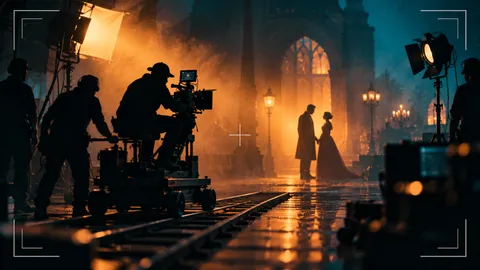
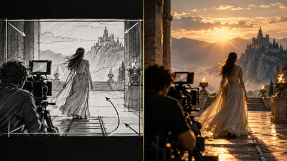

<div align="center">

# 🎬 Cinematic Skills

**Put the masters' filmmaking wisdom into your AI assistant**

Agent Skills distilled from 6 classic books on cinematic technique — shot design × scene transitions

[中文](README.md) | **English**




</div>

---

## 📦 Included Skills

| Skill | Focus | Chapters | Best for |
|---|---|---|---|
| **cinematic-shots** | Shoot like a master | 55 | Shot design, dialogue/action/suspense scenes, breakdowns of classic scenes |
| **cinematic-transitions** | Transition like a master | 10 | Scene transitions, pacing, editorial storytelling |

> Note: the skill content itself is written in **Chinese**. Agents can still answer in English from it, but the source material is Chinese.

<p align="center">
  
  &nbsp;
  
</p>
<p align="center">
  <sub>cinematic-shots — orbital blocking</sub> &nbsp;&nbsp;&nbsp;&nbsp; <sub>cinematic-transitions — dissolve &amp; bridging</sub>
</p>

## 🗂 Repository Layout

```
cinematic-skills/
├── cinematic-shots/              # Shoot like a master
│   ├── SKILL.md                  # Entry: core frameworks + chapter/topic index
│   ├── chapters/                 # 55 chapter distillations (loaded on demand)
│   ├── glossary.md               # 46 terms
│   ├── patterns.md               # 30 technique patterns (when / how / trade-offs)
│   ├── cheatsheet.md             # Decision quick-reference (rules + decision paths)
│   └── _index-*.md               # Per-volume chapter maps
│
└── cinematic-transitions/        # Transition like a master
    ├── SKILL.md                  # Entry: 10 core frameworks of scene transition
    ├── chapters/                 # 10 chapter distillations
    ├── glossary.md               # 53 terms
    ├── patterns.md               # 20 transition patterns
    └── cheatsheet.md             # Transition decision tree + trade-off matrix
```

## 🚀 Installation

**Option 1: skills CLI (any Agent-Skills-compatible host)**

```bash
npx skills add https://github.com/gxgleo67/cinematic-skills --skill cinematic-shots
npx skills add https://github.com/gxgleo67/cinematic-skills --skill cinematic-transitions
```

**Option 2: manual copy**

Copy `cinematic-shots/` and `cinematic-transitions/` into your skills directory:

| Host | Directory |
|---|---|
| Kimi Code | `~/.kimi-code/skills/` |
| Claude Code | `~/.claude/skills/` |
| Copilot CLI / Codex | `~/.agents/skills/` |

Restart the session so the skills get discovered.

## 💡 Usage Examples

Ask in Chinese or English — the agent will locate and read the right chapter file:

```
How does cinematic-shots build tension in a chase scene?
How do I block a multi-character dialogue with cinematic-shots?
cinematic-transitions: how do I bridge two scenes with clashing emotions?
What's in chapter ch08 of cinematic-transitions?
```

Ask without arguments to load the core-framework quick reference; ask with a topic to jump straight to the relevant chapter.

## 📖 Case Study

[Designing a "confession scene" end-to-end](examples/案例-坦白戏.md) (content in Chinese) — from transition-in to shot execution, showing how an agent uses both skills, with every decision annotated with its source chapter.

## ✨ Highlights

- **Structure, not book notes** — every chapter file is a toolkit: technique name + when to use + how to execute + anti-patterns + a real film example
- **Original terminology preserved** — the authors' exact technique names are kept
- **400+ numbered techniques, full coverage** — verified section by section, zero gaps
- **Conflicts reconciled** — contradictory advice across sources is annotated with precedence and exceptions
- **Decision-oriented** — the cheatsheet is judgment logic ("when X, do Y, because Z"), not a keyword list

## 🎞 From Storyboard to Screen

The only thing between a storyboard sketch and the final frame is the right method:

<p align="center">
  
</p>

---

<div align="center">
<sub>Made with Kimi Code</sub>
</div>
